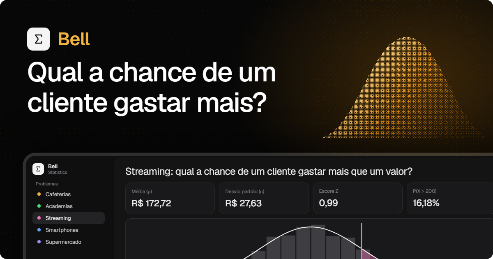

<p align="center">
  
</p>

<p align="center">
  
  
  
  
  
</p>

# Distribuição normal: gasto mensal de clientes

🔗 **Site no ar: https://edgarcsr.github.io/statistics-normal-distribution/**

Trabalho de estatística sobre **distribuição normal**. O site responde, para cada setor pesquisado, a pergunta:

> Qual a chance de um cliente gastar mais que um valor X por mês?

## Integrantes do grupo

- Nicholas Birochi, RA 081230038
- Henrico Birochi, RA 081230027
- Vítor Agostino Braghittoni, RA 081230024
- Edgar Camacho Seabra Ribeiro, RA 081230039

## Como funciona

1. Lê a coluna `gasto_mensal` do CSV do setor (1200 clientes cada).
2. Calcula a média (μ) e o desvio padrão (σ).
3. Calcula o escore Z: `Z = (x − μ) / σ`.
4. Obtém `P(X > x) = 1 − Φ(Z)`, o mesmo valor da tabela Z.
5. Compara com a proporção real de clientes acima de X, para ver se a aproximação normal é boa.

O gráfico mostra o histograma dos clientes reais, a curva normal e a área que representa a probabilidade.

Setores: cafeterias, academias, streaming, smartphones e supermercado. Os CSVs ficam em `public/data/`.

## Onde está cada coisa

| Arquivo | O que faz |
| --- | --- |
| `src/lib/dados.ts` | Lê o CSV, calcula média, desvio padrão e escore Z |
| `src/lib/normal.ts` | Funções da normal (`pdf`, `cdf`) |
| `src/lib/setores.ts` | Lista dos problemas (arquivo, valor de exemplo, cor) |
| `src/lib/i18n.tsx` | Textos em português e inglês |
| `src/routes/problema.$setor.tsx` | Página de cada problema |
| `src/components/grafico.tsx` | Histograma + curva normal em SVG |
| `src/components/app-sidebar.tsx` | Menu lateral com os problemas e o seletor de idioma |

## Rodando

```bash
bun install
bun run dev
```

Abre em http://localhost:3000.

```bash
bun run check   # lint e formatação (Ultracite)
bun run build   # build de produção
```

## Stack

React 19, TanStack Router, Vite, Tailwind v4, shadcn/ui (Base UI) e Ultracite (oxlint + oxfmt).

## Skills usadas

- **[unslop](https://github.com/heydamir/unslop)** (`.claude/skills/unslop`): guia o visual da interface (paleta grafite com um acento âmbar, tipografia Geist, sem enfeites de "UI genérica de IA").
- **[banner](https://github.com/Edgarcsr/banner-skill)**: gerou o banner do topo (`assets/banner/`). Para refazer: `cd assets/banner && bun build.ts` e renderizar o `banner.html` com a skill.
- **Ultracite** (`AGENTS.md`): regras de código e lint do projeto.
